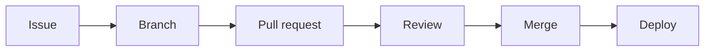

# Contributing to {{PROJECT_NAME}}

> **Purpose:** How we work together: branches, commits, pull requests, reviews and merging. Coding standards live in [RULES.md](RULES.md).
> **Owner:** {{TECH_LEAD}} · **Review:** every 6 months

## Workflow

Every change follows the same path. No direct pushes to `{{MAIN_BRANCH}}`.



1. Start from an issue in {{ISSUE_TRACKER_URL}} so the *why* is written down.
2. Branch, commit, open a PR, get it reviewed, squash-merge.
3. Deploy following [docs/DEPLOYMENT.md](docs/DEPLOYMENT.md).

## Branches

- Branch from the latest `{{MAIN_BRANCH}}`. Name it `type/short-description`, e.g. `feat/export-csv`, `fix/login-timeout`.
- Types: `feat`, `fix`, `docs`, `refactor`, `test`, `chore`.
- Keep branches short-lived: merge within 2 days. Long-lived branches mean painful merges.
- Hide unfinished work behind a feature flag rather than keeping a branch open.

## Commits

We use [Conventional Commits](https://www.conventionalcommits.org/en/v1.0.0/): `type(scope): summary`.

- Summary is imperative ("add", not "added"), lower case, ≤ 72 characters, no trailing period.
- Types: `feat`, `fix`, `docs`, `refactor`, `test`, `chore`, `perf`, `build`, `ci`.
- Breaking changes add `!` after the type and a `BREAKING CHANGE:` footer.

```text
feat(auth): add password reset by email
fix(orders): return 404 for unknown order id
refactor!: remove legacy v1 endpoints

BREAKING CHANGE: clients must call /v2 endpoints.
```

## Pull requests

- **Small:** aim for fewer than 400 changed lines, excluding generated files and lockfiles. Split larger work into stacked PRs.
- **Title:** use the commit format, because it becomes the squash commit.
- **Description:** fill in the [PR template](.github/PULL_REQUEST_TEMPLATE.md) and link the issue.
- **Self-review first:** read your own diff before requesting review.
- **CI green** before requesting review (see TEST-5 in [RULES.md](RULES.md#testing)).
- Open a **draft PR** early when you want feedback on direction.

## Code review

**Authors:** respond to every comment; resolve the thread only when it's addressed.

**Reviewers:**

- Respond within **1 business day**. Reviewing beats starting new work.
- Check correctness, tests, readability, security, and [RULES.md](RULES.md). Cite rule IDs.
- Prefix comments so intent is clear:

| Prefix | Meaning | Blocks merge? |
|---|---|---|
| `blocking:` | Must change before merge | Yes |
| `question:` | Help me understand | No |
| `nit:` | Small polish, take it or leave it | No |

- Approve when you would be comfortable owning this code. A PR needs **{{REQUIRED_APPROVALS}}** approval(s).

## Merging and reverting

- **Squash-merge** by default; delete the branch after merge.
- The author merges once approvals and CI are green.
- If a merged change breaks something, **revert first, fix forward after**: open a revert PR, merge it, then fix calmly.
- For production incidents, follow the rollback steps in [docs/DEPLOYMENT.md](docs/DEPLOYMENT.md#rollback).

## Definition of Done

A change is done when all of these are true:

- [ ] Acceptance criteria in the issue are met
- [ ] Tests added or updated (TEST-1, TEST-2) and CI is green
- [ ] Reviewed and approved
- [ ] Docs updated in the same PR (DOC-1)
- [ ] Entry added under *Unreleased* in [CHANGELOG.md](CHANGELOG.md) for user-visible changes
- [ ] No secrets or personal data in code, logs or fixtures
- [ ] Deployed and verified, or ready for the next release

## Team specifics

<!-- ADD: how reviewers are assigned (round-robin, code owners, area experts) -->

<!-- ADD: the CI checks that must pass and how to rerun them -->

<!-- ADD: release cadence (continuous, weekly, per sprint) and who cuts releases -->
