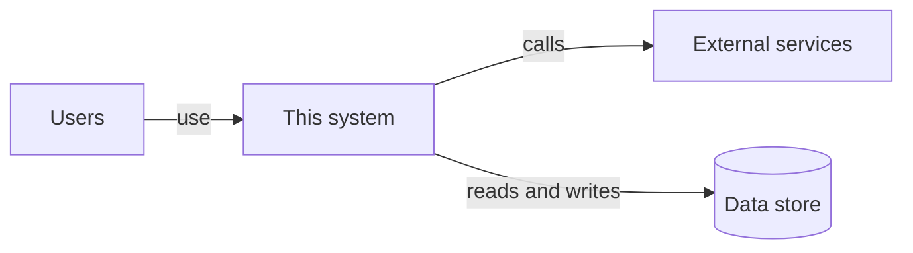
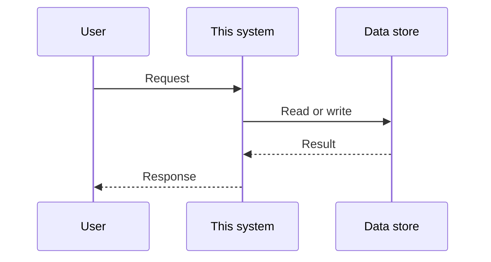

# Architecture — {{PROJECT_NAME}}

> **Purpose:** How the system is built: its parts, how data moves, and what it depends on. *Why* it exists lives in [INTENT.md](../INTENT.md).
> **Owner:** {{TECH_LEAD}} · **Review:** in the PR that changes structure; full pass quarterly

Structure follows a light version of the C4 model: start wide (context), then zoom in (components). Keep each section short; link out for detail.

## System context

Who and what the system talks to. One box for the system, one per user group and external system.

<!-- ADD: replace the generic nodes below with your real users and external systems -->

## Components

The deployable or logical parts inside the system.

| Component | Responsibility | Owner |
|---|---|---|
| <!-- ADD: one row per component; one sentence of responsibility each --> | | |

## Data flow

The most important request or job, end to end.

<!-- ADD: replace with your most important flow; add one diagram per critical flow if needed -->

## Data and storage

<!-- ADD: each data store, what it holds, who owns the schema, retention, and backup approach -->

## External dependencies

| Dependency | Purpose | Owner | Failure impact |
|---|---|---|---|
| <!-- ADD: one row per third-party service or other team's system; what happens to us when it is down --> | | | |

## Cross-cutting concerns

| Concern | Approach |
|---|---|
| Authentication and authorization | <!-- ADD: how users and services prove identity and what they may do --> |
| Observability | Structured logs, levels and correlation IDs per [RULES](../RULES.md#logging-and-observability). <!-- ADD: where logs, metrics and traces go --> |
| Configuration | From the environment per [RULES](../RULES.md#configuration). <!-- ADD: where config and secrets come from --> |
| Error handling | Per [RULES](../RULES.md#error-handling). <!-- ADD: retry, timeout and fallback strategy --> |

## Quality attributes

The non-functional targets the design must meet. Make them measurable.

| Attribute | Target | How measured |
|---|---|---|
| Availability | <!-- ADD: e.g. 99.9% monthly --> | |
| Latency (p95) | <!-- ADD: e.g. < 300 ms for key endpoints --> | |
| Throughput | <!-- ADD: e.g. requests per second at peak --> | |
| Scalability | <!-- ADD: expected growth and how the system scales --> | |

## Key terms

Domain words with a precise meaning here. Use them consistently in code, docs and conversation.

| Term | Meaning |
|---|---|
| <!-- ADD: one row per domain term --> | |

## Known limitations and tech debt

Be honest; this list guides future work.

| Limitation | Impact | Plan |
|---|---|---|
| <!-- ADD: one row per known limitation or debt item --> | | |

## Decisions

Significant design decisions live in [Architecture Decision Records](adr/README.md). Link the relevant ADR from the section it affects.

## Keeping this current

- Update this file in the same PR as any structural change ([DOC-1](../RULES.md#documentation)).
- Diagrams are Mermaid text: edit them like code, review them in the diff.
- Do a full read-through quarterly and delete anything no longer true.
