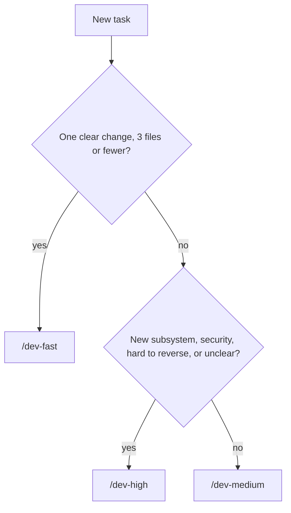

# Claude Commands — {{PROJECT_NAME}}

> **Purpose:** Which Claude Code command to type for which job, from a quick fix to a full-process feature.

## Pick a mode

Three project commands live in `.claude/skills/`. Pick one by the size and risk of the work:

| Mode | Use when | What it does | Cost |
|---|---|---|---|
| `/dev-fast` | Typo, obvious bug, config tweak; 1–3 files | Straight to the change; affected tests only; minimal task file in one approval; 5-line report | Lowest tokens, fastest |
| `/dev-medium` | Feature or bug across a few files; up to about a day | Short design you approve; test-first; full test and lint run; self-review; task file at milestones | Moderate |
| `/dev-high` | New subsystem, hard-to-reverse decision, security-sensitive, or unclear requirements | Brainstorm → spec → plan → fresh agent and review per task → final fresh review → permanent docs | Highest; best outcome |



```text
/dev-fast #98 login timeout is 5s, should be 30s
/dev-medium @docs/tasks/123-export-csv.md
/dev-high #140 add role-based permissions to the admin area
```

- **Unsure? Go one level up.** A mode that finds the work bigger than expected stops and suggests the next one. Modes only step up mid-task, never down.
- **Cheaper still:** before `/dev-fast`, switch to a faster model with `/model`.
- `/dev-high` needs the superpowers plugin; see [Install once](#install-once).

## How commands work

| You type | What happens |
|---|---|
| `/name` | Runs a built-in command or a skill, e.g. `/dev-fast` |
| `/plugin:skill` | Runs a skill from a plugin, e.g. `/superpowers:brainstorming` |
| `@path` | Attaches a file, plus the CLAUDE.md files above it, e.g. `@docs/tasks/123-export-csv.md` |
| `Shift+Tab` | Cycles permission modes; stop at plan mode to approve a plan before any edit |
| `/skills` | Lists the skills you actually have |

Write the command first, then the files, then what you want:

```text
/superpowers:systematic-debugging @docs/tasks/98-login-timeout.md Sessions end after 5 seconds.
```

## Install once

| Plugin | Needed for | Install |
|---|---|---|
| superpowers | `/dev-high` and the `/superpowers:` commands below | `/plugin install superpowers@claude-plugins-official` |
| agent-skills (optional) | The alternative workflow below | `/plugin marketplace add addyosmani/agent-skills`, then `/plugin install agent-skills@addy-agent-skills` |

Check with `/skills`. Sources: [obra/superpowers](https://github.com/obra/superpowers), [addyosmani/agent-skills](https://github.com/addyosmani/agent-skills).

## Commands by job

| I want to… | Command | Example |
|---|---|---|
| Understand the repo | Plain prompt | `Give me an overview of this codebase @README.md` |
| Clarify an idea before building | `/superpowers:brainstorming` | `/superpowers:brainstorming @docs/tasks/123-export-csv.md Design the CSV export` |
| Turn a spec into a plan | `/superpowers:writing-plans` | `/superpowers:writing-plans @docs/superpowers/specs/2026-01-10-export-csv-design.md` |
| Run a plan, fresh agent per task | `/superpowers:subagent-driven-development` | `/superpowers:subagent-driven-development @docs/superpowers/plans/2026-01-10-export-csv.md` |
| Run a plan myself, in this session | `/superpowers:executing-plans` | `/superpowers:executing-plans @docs/superpowers/plans/2026-01-10-export-csv.md` |
| Write the test first | `/superpowers:test-driven-development` | `/superpowers:test-driven-development Add a regression test for #98, then fix it` |
| Find the cause of a bug | `/superpowers:systematic-debugging` | `/superpowers:systematic-debugging The export times out above 10k rows` |
| Prove it works before saying done | `/superpowers:verification-before-completion` | `/superpowers:verification-before-completion Confirm #98 is fixed` |
| See the change in the running app | `/verify` | `/verify the CSV download button` |
| Review my changes | `/code-review` | `/code-review high` |
| Act on review comments | `/superpowers:receiving-code-review` | `/superpowers:receiving-code-review Address the comments on PR #45` |
| Simplify the changed code | `/simplify` | `/simplify` |
| Check my changes for security issues | `/security-review` | `/security-review` |
| Work on two things in parallel | `claude --worktree NAME` (terminal) | `claude --worktree export-csv` |
| Merge, open a PR, or discard a branch | `/superpowers:finishing-a-development-branch` | `/superpowers:finishing-a-development-branch` |
| Continue yesterday's session | `claude --continue` (terminal) | Then: `Continue from Progress in @docs/tasks/123-export-csv.md` |
| Free up context in a long session | `/compact` | `/compact keep the task file and test results` |
| Fix a broken Claude Code setup | `/doctor` | `/doctor` |

## Optional: agent-skills workflow

If you installed agent-skills, it adds a lighter command flow: `/spec` → `/plan` → `/build` → `/test` → `/agent-skills:review` → `/ship`. Use `/agent-skills:review`, because plain `/review` is a built-in. Its router skill picks a skill for you:

```text
/agent-skills:using-agent-skills @CLAUDE.md Review the repo and suggest the next task.
```

Its strongest extras are its security-and-hardening, performance-optimization, ci-cd-and-automation and shipping-and-launch skills. Use **one workflow per task**: mixing superpowers and agent-skills on the same task gives Claude conflicting instructions.

## Your extra skills

<!-- ADD: personal or team skills you rely on, with the command and one example each -->

## Stack skills

<!-- ADD: skills for this project's stack (framework-specific review, test writing, migrations), with an example each -->

## Tips

- One mode or skill per message, first thing in the message.
- Attach the task file so Claude starts from the plan, not from scratch.
- Say what "done" looks like: "done when the export test passes".
- Command not found? Run `/skills`; the plugin may be missing.
