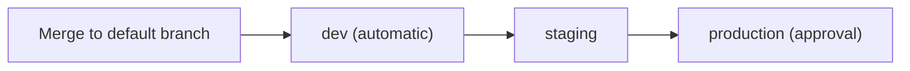

# Deployment — {{PROJECT_NAME}}

> **Purpose:** How changes reach production safely, and how to undo them fast.
> **Owner:** {{TECH_LEAD}} · **Review:** after any failed deploy or rollback

## Environments

| Environment | URL | Purpose | Who can deploy | Data |
|---|---|---|---|---|
| dev | <!-- ADD --> | Integration of merged work | Automatic on merge | Synthetic |
| staging | <!-- ADD --> | Release candidate, production-like | Any engineer | Synthetic or anonymized |
| production | <!-- ADD --> | Real users | <!-- ADD: approvers --> | Real |

Never copy production data into lower environments without anonymizing it first.

## Promotion flow

The same build artifact moves through every environment; only configuration changes.

## Release checklist

**Before**

- [ ] CI green on the commit being released
- [ ] Verified on staging
- [ ] CHANGELOG updated; migrations reviewed (see [Database migrations](#database-migrations))
- [ ] Rollback plan known; on-call aware of the release

**During**

- [ ] Deploy, then watch error rate, latency and key business metrics for 15 minutes

**After**

- [ ] Smoke-test the critical journeys
- [ ] Tag the release and announce it in {{TEAM_CHANNEL}}

## Versioning

- [SemVer](https://semver.org/spec/v2.0.0.html): `MAJOR.MINOR.PATCH`. Breaking change bumps MAJOR, new feature bumps MINOR, fix bumps PATCH.
- Tag releases as `vX.Y.Z` in git.
- Move *Unreleased* entries into the new version section of [CHANGELOG.md](../CHANGELOG.md).

## Rollback

**Roll back first, debug later.** Restoring service beats finding the cause.

- **Target:** production rolled back within 15 minutes of the decision.
- Anyone on the release or on-call may decide to roll back; no approval needed.

1. Redeploy the previous known-good tag.
2. Verify error rate and key metrics recover.
3. Announce the rollback in {{TEAM_CHANNEL}}.
4. If users were affected, open an incident per [RUNBOOK.md](RUNBOOK.md).

<!-- ADD: the exact rollback commands or pipeline steps -->

## Feature flags

- Ship risky or unfinished work behind a flag; deploy dark, then release by turning the flag on.
- Every flag has an **owner** and a **removal date**.
- Remove the flag within 30 days of full rollout. Old flags are hidden complexity.

## Database migrations

Use **expand → migrate → contract** so every deploy can be rolled back:

1. **Expand:** add new columns or tables; the old code keeps working.
2. **Migrate:** deploy code that writes both and reads new; backfill data.
3. **Contract:** remove the old structure in a later release.

- Each migration is compatible with the previously deployed version.
- Never drop or rename in the same release as the code change that stops using it.
- Test migrations against a production-sized, anonymized copy before release.

## Deploy freezes

- During a freeze, no non-urgent production deploys.
- Urgent fixes during a freeze need {{TECH_LEAD}} approval.
- Avoid deploying right before weekends or holidays unless someone is available to roll back.

<!-- ADD: freeze windows (peak sales, end of quarter, holidays) -->

## Pipeline specifics

<!-- ADD: pipeline stages, where to watch a deploy, required approvals, how to rerun a failed stage -->
