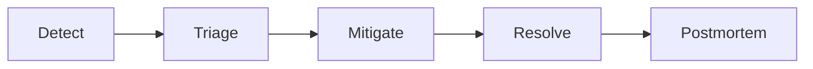

# Runbook — {{PROJECT_NAME}}

> **Purpose:** What to do when things break: severity, incident process, roles, and step-by-step entries for known problems.
> **Owner:** {{TEAM_NAME}} · **Review:** after every SEV1/SEV2, and quarterly

## Severity levels

| Level | Definition | Respond within | Who is paged |
|---|---|---|---|
| SEV1 | Outage, data loss, or security breach | 15 minutes | On-call + tech lead |
| SEV2 | Core feature degraded for many users | 30 minutes | On-call |
| SEV3 | Partial impact; a workaround exists | Next business day | None (ticket) |
| SEV4 | Cosmetic or minor | Normal backlog | None |

When unsure, pick the higher severity. Downgrading later is cheap.

## Incident process



1. **Detect:** an alert, a user report, or a teammate notices.
2. **Triage:** set severity, name an incident commander, open an incident channel.
3. **Mitigate:** stop the bleeding first. Mitigate before root-causing: roll back, turn a flag off, scale up.
4. **Resolve:** confirm metrics are healthy; announce resolution.
5. **Postmortem:** for SEV1 and SEV2, see [Postmortems](#postmortems).

## Roles

| Role | Responsibilities |
|---|---|
| Incident commander | Owns the incident, makes decisions, assigns work. Doesn't debug. |
| Communications | Posts status updates to stakeholders on a fixed cadence. |
| Scribe | Keeps a timestamped timeline of actions and findings. |

In a small incident, one person can hold several roles. Say so explicitly.

## Status updates

Post every 30 minutes for SEV1/SEV2, even if nothing changed.

```text
[SEV2] Checkout errors for some users
Status: Investigating | Identified | Monitoring | Resolved
Impact: who is affected and how
Current action: what we are doing now
Next update: HH:MM
```

## Postmortems

Required for SEV1 and SEV2, within 5 business days. **Blameless:** focus on systems and processes, not people.

```text
Summary        What happened, in two sentences
Impact         Who was affected, for how long, how badly
Timeline       Timestamped events from detection to resolution
Root cause     Why it happened; ask "why" until you reach a fixable cause
What went well
What went wrong
Action items   Each with an owner and a due date
```

## Runbook entries

One entry per known problem. Copy this template:

```text
Symptom      What you see (alert name, error, user report)
Impact       Who is affected
Diagnosis    How to confirm the cause: dashboards, queries, log searches
Mitigation   Steps to restore service
Escalation   Who to call if mitigation fails
```

### High error rate after a deploy

- **Symptom:** error-rate alert fires within an hour of a release.
- **Impact:** some or all requests fail.
- **Diagnosis:** compare the error rate before and after the deploy time; check the release diff.
- **Mitigation:** roll back per [DEPLOYMENT.md](DEPLOYMENT.md#rollback), then investigate.
- **Escalation:** the release author, then {{TECH_LEAD}}.

<!-- ADD: one entry per known problem for this service -->

## Dashboards and alerts

| Alert | Meaning | First step | Dashboard |
|---|---|---|---|
| <!-- ADD: one row per alert; every alert needs a first step --> | | | |

## Escalation

| Level | Who | When |
|---|---|---|
| 1 | {{ONCALL_CONTACT}} | Any alert or incident |
| 2 | {{TECH_LEAD}} | SEV1, or SEV2 not mitigated within 1 hour |
| Security | {{SECURITY_CONTACT}} | Any suspected breach or data exposure |

<!-- ADD: other teams, vendors and support contracts to escalate to -->
